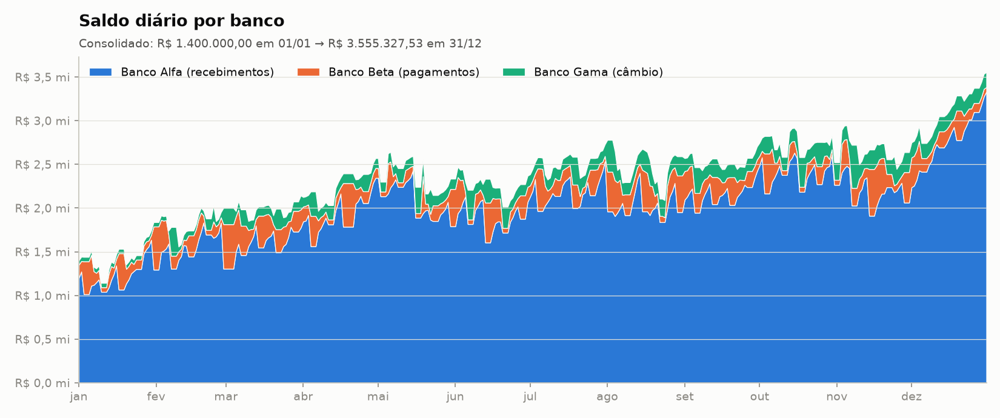
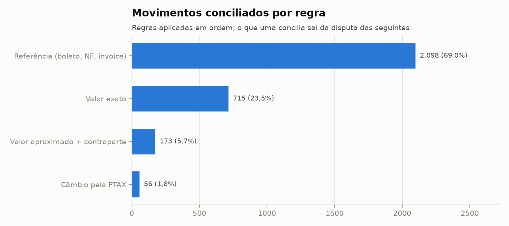
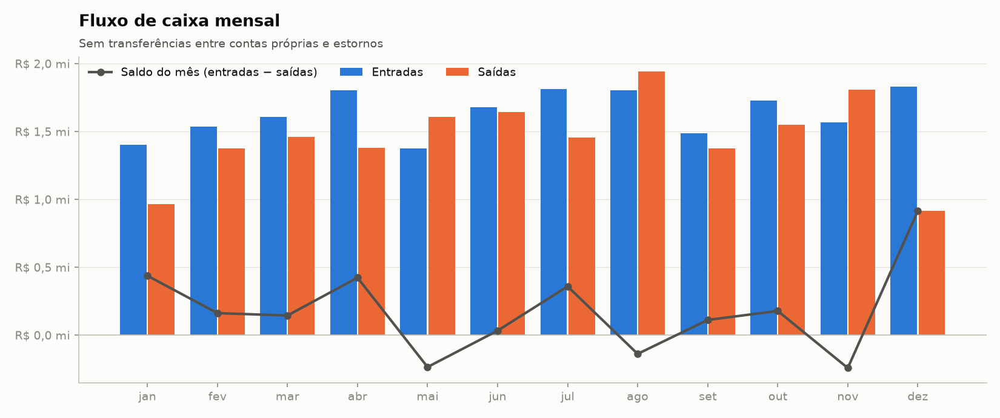
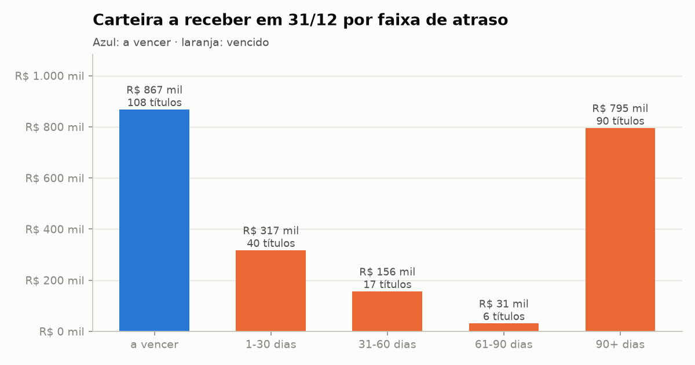

# 03 · Financial Transactions

Fechamento financeiro de um ano em **Python + Pandas**:
- **controle de integridade** dos extratos de 3 bancos
- **conciliação bancária** contra os títulos do ERP
- **fluxo de caixa** e séries temporais
- **auditoria de pagamentos** com detecção de fraudes e erros

Os resultados são medidos contra um gabarito.

```text
Banco Alfa (CSV ; com BOM, blocos mensais) ─┐
Banco Beta (CSV decrescente, "pending")  ───┼─ extração ─ limpeza ─ controles (trailer, saldo corrido)
Banco Gama (largura fixa / CNAB)  ──────────┘                │
ERP (títulos) · contrapartes · PTAX ──────────── classificação ─ conciliação (4 regras) ─ caixa ─ auditoria
                                                                       │
                                                  validação ─ avaliação ─ relatório · 24 CSVs · 7 gráficos
```

**Nível:** 2–3 (múltiplas fontes, regras de negócio, séries temporais) · **Stack:** Python 3.11+, Pandas, NumPy, Matplotlib, pytest

---

## Problema e contexto

A **Andes Distribuidora de Alimentos** vende para supermercados e restaurantes, compra de
fornecedores nacionais e importa café, azeite e especiarias em dólar e euro. Todo mês o
financeiro precisa responder:

- O que entrou e saiu de cada banco corresponde a qual título do ERP?
- O ERP está em dia, ou há títulos pagos sem baixa e baixas sem dinheiro?
- Os extratos estão completos?
- Algum pagamento é suspeito?
- Como está o caixa, quem está devendo e quanto vai entrar e sair nas próximas semanas?

Cada fonte tem seu formato e seus vícios:

| Fonte | Formato | Linhas | Particularidades |
|---|---|---|---|
| `banco_alfa_extrato.csv` | CSV `;` UTF-8 **com BOM** | 2.479 | concatenação de exportações mensais: cabeçalho repetido e linha `SALDO ANTERIOR` por mês; valor positivo + coluna D/C; decimal com vírgula |
| `banco_beta_extrato.csv` | CSV `,` de banco digital | 846 | ordem **decrescente**; lançamentos `pending` duplicando os `posted` |
| `banco_gama_cnab.txt` | **largura fixa** (estilo CNAB) | 230 | header, detalhes e **trailer com totais de controle**; uma linha corrompida na transmissão; sem saldo |
| `erp_titulos.csv` | CSV | 3.459 | sinal invertido em contas a pagar, moeda escrita de 9 formas, datas em 2 formatos, 12 lançamentos duplicados, status divergente do banco |
| `contrapartes.csv` | CSV | 157 | 120 clientes e 37 fornecedores (5 importadores) |
| `ptax.csv` | CSV `;` estilo Banco Central | 622 | dias sem cotação, 2 cotações 10x maiores (vírgula fora do lugar), 1 zerada, duplicadas |

## Objetivo

1. Provar que os extratos estão completos antes de conciliar.
2. Conciliar cada recebimento e pagamento com o título correspondente, de forma 1:1 e explicando as diferenças (juros, desconto, câmbio).
3. Apontar as divergências entre banco e ERP.
4. Produzir a visão de caixa: saldo diário, fluxo mensal, *aging* e projeção.
5. Priorizar pagamentos suspeitos para a auditoria.
6. **Medir** a qualidade de tudo contra o gabarito.

## Origem dos dados

Dados **sintéticos** gerados por [`scripts/generate_data.py`](scripts/generate_data.py) (semente fixa).

O gerador simula o ano de 2025:
- vendas com prazos de 21 a 45 dias, em que os clientes pagam em dia, adiantado com desconto ou atrasado com multa de 2% e juros de 1% ao mês
- compras de fornecedores recorrentes (aluguel, energia, software) e eventuais
- importações pagas no vencimento à PTAX + spread do banco, mais IOF
- folha de pagamento, impostos, tarifas e rendimentos
- transferências semanais entre as contas e PIX devolvidos

Depois ele insere fraudes e erros, remove linhas do extrato, corrompe uma linha do arquivo CNAB e grava o **gabarito** em `data/external/`. O gabarito é usado só na avaliação final.

> Empresas, valores e cotações são fictícios.

## Processo de tratamento — principais decisões

### Limpeza ([`src/clean.py`](src/clean.py))

| Decisão | Por quê |
|---|---|
| **Dinheiro em centavos inteiros** (`Int64`) | `0.1 + 0.2 != 0.3` em float. Somando milhares de lançamentos, o erro aparece no centavo. Com inteiros a soma é exata e os controles podem exigir igualdade. |
| Tudo lido como texto | `1.234,56` e `-1234.56` convivem nas fontes; a conversão é explícita. |
| Alfa: `encoding="utf-8-sig"` + remoção de cabeçalhos repetidos | O BOM grudaria no nome da primeira coluna (`Data`). |
| Beta: reordenar e descartar `pending` | Só `posted` movimenta saldo. Pendentes com gêmeo liquidado são duplicatas; os sem gêmeo estão em trânsito. |
| Gama: linha com valor ilegível vai para a quarentena | O valor dela não se perde: o trailer revela qual era. |
| Títulos: `abs()` no valor, moeda em branco herdada do cadastro | O módulo de pagar grava parte dos valores negativos; importadores sempre faturam em USD/EUR. |
| Lançamento duplicado no ERP: fica o baixado | Dos dois, o que foi pago é o verdadeiro. |
| PTAX: rejeita cotação zerada ou a mais de 20% da **mediana móvel** da moeda | Pega a vírgula fora do lugar sem lista manual. |

### Controles dos extratos ([`src/source_checks.py`](src/source_checks.py))

- **Trailer do CNAB:** quantidade de registros e soma de débitos e créditos. A diferença entre o trailer e o que foi lido é o valor da linha ilegível.
- **Saldo corrido:** saldo de abertura mais a soma acumulada deve reproduzir o saldo informado em cada linha. Cada salto na diferença indica um lançamento faltando logo antes, e o tamanho do salto é o valor do lançamento.

### Classificação ([`src/classify.py`](src/classify.py))

Regras sobre o histórico separam tarifa, imposto, folha, rendimento e transferência interna. As **transferências entre contas próprias** são pareadas por valor em até D+2 **dias úteis** (`np.busday_count` com feriados): sair na sexta e cair na segunda é D+1, não D+3. Os **estornos** anulam o envio anterior mais próximo, usando a sequência de lançamentos do banco.

### Conciliação ([`src/reconcile.py`](src/reconcile.py))

| Ordem | Regra | Liga quando… | Desempate |
|---|---|---|---|
| 1 | `referencia_documento` | o histórico cita o nosso número, a invoice ou a NF + a contraparte | data mais próxima do vencimento |
| 2 | `valor_exato` | mesmo valor em reais, no sentido certo, perto do vencimento | contraparte citada, depois data |
| 3 | `valor_aproximado_nome` | variação entre −6% e +12% e contraparte citada | **resíduo contratual**: distância do valor esperado com multa + juros pro rata ou desconto |
| 4 | `cambio_ptax` | moeda × PTAX do **dia do pagamento** (`merge_asof`) dentro do spread de 1,5% | data (câmbio fecha no vencimento) |

- **Ordem das regras:** o que uma regra concilia sai da disputa das seguintes. Os pares são escolhidos de forma gulosa e 1:1, do mais evidente ao menos evidente.
- **Por que o resíduo contratual:** a primeira versão ordenava pela "menor variação" e trocava pagamentos atrasados de dois títulos do mesmo cliente. Usar as condições contratuais eliminou os 8 erros.
- **Câmbio:** a PTAX não existe em fins de semana, feriados e dias sem publicação. O `merge_asof(direction="backward", by="moeda")` busca a última cotação disponível, com defasagem máxima de 7 dias.
- **Natureza da diferença:** cada diferença é classificada em `exato`, `juros_e_multa`, `desconto`, `spread_cambial` ou `divergente`.
- **Cruzamento com o ERP:** a situação de cada título (pago sem baixa, baixado sem movimento, pago mas cancelado) é cruzada com os **lançamentos perdidos** revelados pelos controles.

### Auditoria ([`src/anomalies.py`](src/anomalies.py))

| Regra | Sinal | Peso |
|---|---|---|
| `pagamento_duplicado` | mesmo fornecedor e valor de novo em até 7 dias (self-merge) | 3 |
| `titulo_cancelado_pago` | cancelado no ERP, mas o dinheiro saiu | 3 |
| `fracionamento` | 2+ notas no mesmo dia, cada uma entre 90% e 100% da alçada de R$ 10 mil | 2 |
| `fornecedor_novo` | cadastrado há ≤ 30 dias e recebendo ≥ R$ 50 mil | 2 |
| `valor_atipico` | **z-score robusto** (mediana/MAD) do **log** do valor > 3,5, por fornecedor | 2 |
| `pagamento_fora_de_dia_util` | pago em sábado, domingo ou feriado (`np.is_busday`) | 1 |

O z robusto usa o log porque valores financeiros são assimétricos: uma nota 2x maior é comum, uma 8x maior não é. Mediana e MAD não são distorcidas pelo próprio outlier.

### Validação ([`src/validate.py`](src/validate.py))

- **14 regras críticas** interrompem o pipeline: chaves únicas, todo movimento classificado, cotação para títulos estrangeiros, conciliação estritamente 1:1 e no sentido certo, transferências internas somando zero e saldo final de cada banco igual a abertura + movimentos.
- **8 alertas** formam a lista de pendências do financeiro.

## Arquitetura

```text
03-financial-transactions/
├── main.py                    # orquestra as 8 etapas
├── scripts/generate_data.py   # gera fontes + gabarito
├── src/
│   ├── config.py              # calendário de feriados, dia útil, tolerâncias, alçada, condições contratuais
│   ├── utils.py               # centavos, texto, dias úteis, emparelhamento guloso 1:1
│   ├── extract.py             # read_csv (BOM) · read_fwf (CNAB) · header/trailer
│   ├── clean.py               # extratos unificados, títulos, contrapartes, PTAX
│   ├── source_checks.py       # trailer, saldo corrido, lançamentos perdidos
│   ├── fx.py                  # merge_asof sobre a PTAX
│   ├── classify.py            # categorias, transferências internas, estornos
│   ├── reconcile.py           # 4 regras de conciliação + situação dos títulos
│   ├── cashflow.py            # saldo diário, resample, rolling, aging, projeção
│   ├── anomalies.py           # 6 regras de auditoria + Lei de Benford
│   ├── validate.py            # regras críticas e alertas
│   ├── evaluate.py            # precisão/recall contra o gabarito
│   ├── load.py · report.py · visualize.py
├── tests/                     # 33 testes (unidade + ponta a ponta)
├── data/raw · data/external · data/processed
└── output/                    # relatorio.md · reports/ (24 CSVs) · charts/ (7 PNGs)
```

**Saídas em `data/processed/`:**
- `movimentos.csv`: categoria, par e situação de cada movimento
- `titulos.csv`: situação e explicação de cada título
- `conciliacao.csv`: regra, diferença e natureza de cada vínculo
- `rejeitados.csv`: registros em quarentena
- `ptax_validada.csv`

## Recursos de Pandas usados

`read_csv(encoding="utf-8-sig", skip_blank_lines=False)` · **`read_fwf(colspecs=...)`** ·
**`merge_asof(by=, direction=, tolerance=)`** · **`resample("ME")`** · **`rolling("30D")`** ·
`pivot_table` (inclusive com `aggfunc=["count", "sum"]`) · `reindex` em calendário completo ·
`cumsum` · `diff` · `pd.cut` (aging) · `CustomBusinessDay` · `np.busday_count` / `np.is_busday` ·
self-merge e `merge(how="cross")` · `groupby().transform("median")` · `str.extract` · `Int64` (nullable) ·
`np.select`.

**Aprendizados de pandas 3 neste projeto:**
- `merge_asof` exige chaves exatamente do mesmo tipo, e existem dois tipos de string (`str` e `string`).
- Booleanos vindos do PyArrow não multiplicam por inteiro sem `astype(int)`.
- Nomes de coluna devem ser explícitos antes de merges entre tabelas com colunas homônimas, para não depender de `_x` e `_y`.

## Como executar

```bash
cd 03-financial-transactions
python3 -m venv .venv && source .venv/bin/activate   # Windows: python -m venv .venv && .venv\Scripts\activate
pip install -r requirements.txt
```

```bash
python main.py
```

```bash
pytest
```

Regenerar as fontes e o gabarito (opcional, mesma semente):

```bash
python scripts/generate_data.py
```

A execução completa leva menos de 1 segundo.

## Resultados obtidos

Relatório completo: [`output/relatorio.md`](output/relatorio.md).

| Indicador | Valor |
|---|---|
| Saldo consolidado | R$ 1,40 mi em 01/01 → **R$ 3,56 mi** em 31/12 |
| Entradas / saídas de caixa no ano | R$ 19,64 mi / R$ 17,48 mi |
| Movimentos conciliados | **3.042 de 3.042** (100% nos três bancos) |
| Lançamentos faltando nos extratos | 5, todos encontrados, com valor exato |
| Pagamentos na fila da auditoria | 37 |



### Controles dos extratos

- **Banco Alfa:** o saldo informado em 31/12 é R$ 32.517,39 maior que o recalculado. As 4 quebras do saldo corrido somam exatamente esse valor (R$ 2.474,41 + R$ 11.862,56 + R$ 5.725,55 + R$ 12.454,87). São 4 recebimentos que existiram mas sumiram da exportação.
- **Banco Gama:** o trailer acusa R$ 39.220,91 de débitos a mais do que o lido. É a linha ilegível, que era o pagamento de câmbio de um título em euro.
- **Cruzamento com o ERP:** os 5 lançamentos perdidos explicam 5 dos 7 títulos baixados no ERP sem movimento no banco. Os 2 restantes são erros de baixa de verdade.

### Conciliação (contra o gabarito)

| Regra | Pares | Precisão |
|---|---|---|
| Referência (boleto, NF, invoice) | 2.098 (69,0%) | 100% |
| Valor exato | 715 (23,5%) | 100% |
| Valor aproximado + contraparte | 173 (5,7%) | 100% |
| Câmbio pela PTAX | 56 (1,8%) | 100% |
| **Total** | **3.042** | **100%**, com recall de 99,97% (o único vínculo ausente é a linha ilegível do CNAB) |



**Pendências com o ERP**
- 113 títulos pagos no banco sem baixa no ERP (R$ 1,22 mi).
- 3 títulos cancelados no ERP que foram pagos.
- 2 baixas sem dinheiro no banco.

**Diferenças explicadas**
- R$ 116 mil de juros e multas recebidos de clientes, contra R$ 15,9 mil de descontos concedidos.
- R$ 30 mil de spread cambial pago aos bancos.

### Caixa

| | |
|---|---|
|  |  |

- **Fluxo mensal:** maio, agosto e novembro fecham negativos; o ano termina com R$ 2,16 mi de geração de caixa.
- **Inadimplência:** o atraso médio dos recebimentos sobe de 1,1 dia em janeiro para 5 a 7 dias no resto do ano, e 21,5% dos recebimentos chegam depois do vencimento.
- **Carteira vencida:** R$ 1,32 mi em 31/12, dos quais **R$ 795 mil têm mais de 90 dias**. É o principal ponto de atenção.

### Auditoria de pagamentos (contra o gabarito)

| Regra | Apontados | Acertos | Precisão | Recall |
|---|---|---|---|---|
| Pagamento duplicado | 8 | 8 | 100% | 100% |
| Fracionamento | 12 | 12 | 100% | 100% |
| Fornecedor recém-cadastrado | 3 | 3 | 100% | 100% |
| Pago fora de dia útil | 5 | 5 | 100% | 100% |
| Título cancelado pago | 3 | 3 | 100% | 100% |
| Valor atípico (z > 3,5) | 6 | 4 | 66,7% | 66,7% |

**Escolha do limiar do valor atípico.** A curva abaixo vem de [`avaliacao_limiar_atipico.csv`](output/reports/avaliacao_limiar_atipico.csv):

| Limiar do z robusto | Precisão | Recall |
|---|---|---|
| 2,5 | 54,5% | 100% |
| 3,0 | 75,0% | 100% |
| 3,5 | 66,7% | 66,7% |
| 4,0 | 80,0% | 66,7% |

Nesta base, 3,0 pegaria todas as fraudes. Para uma auditoria, deixar passar uma fraude custa mais do que revisar dois alertas a mais, então 3,0 seria uma escolha defensável. O projeto mantém 3,5, o valor de referência da literatura, para não ajustar o parâmetro olhando a resposta.

**Lei de Benford: não conformidade** (MAD 0,0161), com excesso de valores começando com 9, efeito do fracionamento logo abaixo de R$ 10 mil.
- **Ressalva:** Benford só vale para dados que se espalham por várias ordens de grandeza. Notas de cada fornecedor ficam numa faixa estreita, então a não conformidade aqui é um **indício a investigar, não uma prova**.
- O teste unitário mostra a função dando "conformidade próxima" em dados que seguem a lei.

## Próximas evoluções

- Ler extratos reais em OFX/CNAB 240 e baixar a PTAX da API do Banco Central.
- Conciliação N:1 (uma transferência pagando várias notas).
- Fila de conciliação manual para os pares com resíduo alto.
- Persistir o fechamento em banco SQL e processar só os lançamentos novos (projetos 10–12).
