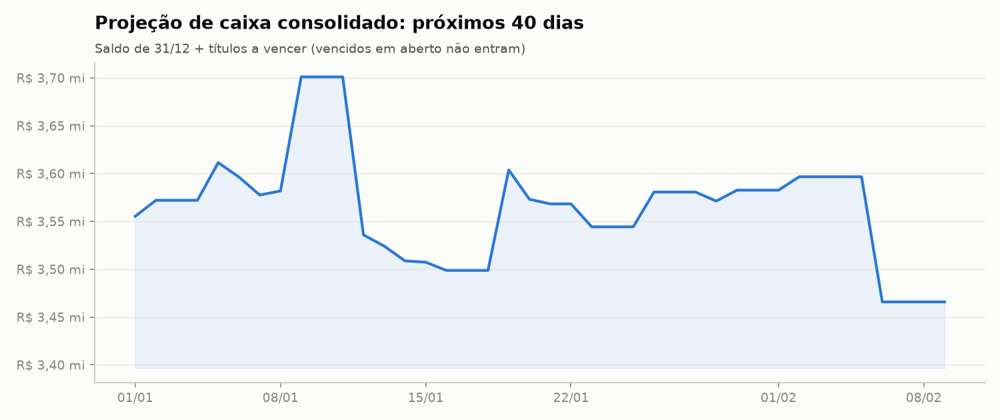
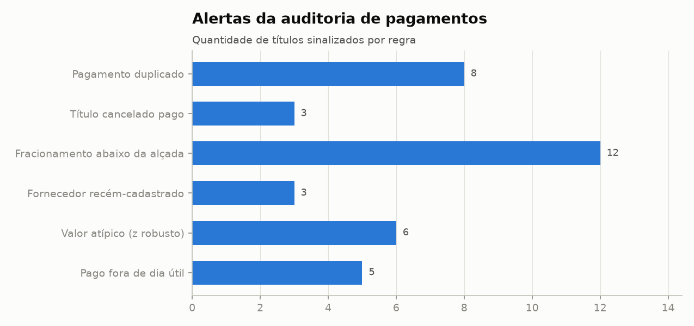
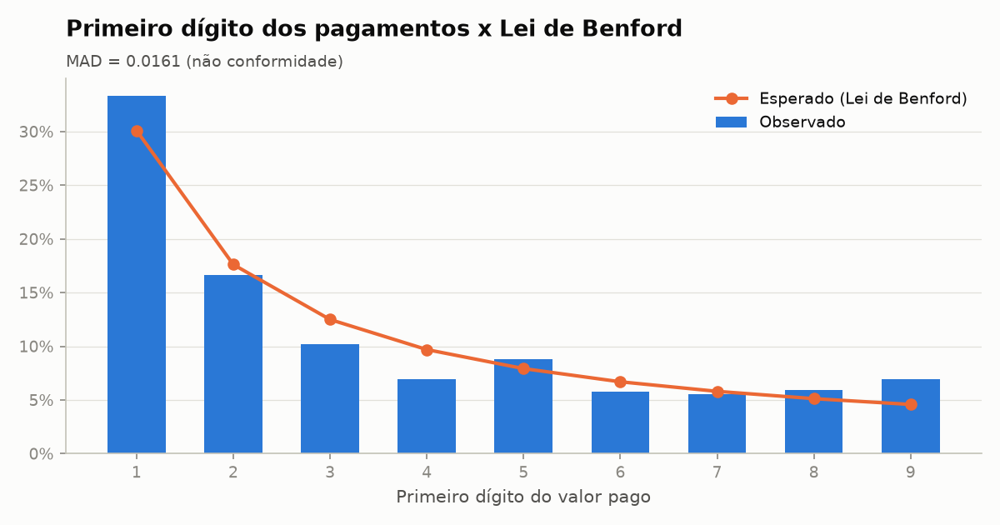

# Fechamento financeiro 2025

_Gerado automaticamente por `python main.py`._

## 1. Resumo

| Indicador | Valor |
|---|---|
| Saldo consolidado em 01/01 | R$ 1.400.000,00 |
| Saldo consolidado em 31/12 | R$ 3.555.327,53 |
| Entradas de caixa no ano | R$ 19.637.692,77 |
| Saídas de caixa no ano | R$ 17.482.365,24 |
| Movimentos conciliados | 3.042 de 3.042 |
| Lançamentos faltando nos extratos | 5 |
| Pagamentos na fila da auditoria | 37 |
| Lei de Benford (MAD) | 0.0161 - não conformidade |

## 2. Controles dos extratos

### Trailer do arquivo CNAB (Banco Gama)

| controle | trailer | lido | diferenca |
|---|---|---|---|
| quantidade de registros | 228 | 228 | 0 |
| total de débitos (centavos) | 481.105.705 | 477.183.614 | 3.922.091 |
| total de créditos (centavos) | 489.400.000 | 489.400.000 | 0 |

### Saldo corrido

| banco | saldo_abertura | saldo_final_calculado | saldo_final_informado | diferenca |
|---|---|---|---|---|
| alfa | 1.200.000,00 | 3.331.413,97 | 3.363.931,36 | 32.517,39 |
| beta | 150.000,00 | 51.749,70 | 51.749,70 | 0,00 |
| gama | 50.000,00 | 172.163,86 |  |  |

### Lançamentos faltando

| banco | data_aproximada | origem | valor |
|---|---|---|---|
| alfa | 03/02/2025 | quebra do saldo corrido | 2.474,41 |
| alfa | 13/06/2025 | quebra do saldo corrido | 11.862,56 |
| alfa | 05/12/2025 | quebra do saldo corrido | 5.725,55 |
| alfa | 18/12/2025 | quebra do saldo corrido | 12.454,87 |
| gama |  | diferença do trailer CNAB | -39.220,91 |

## 3. Conciliação bancária

| banco | movimentos | conciliados | valor_total | taxa_conciliacao_pct |
|---|---|---|---|---|
| alfa | 2.334 | 2.334 | 19.600.986,09 | 100,00 |
| beta | 652 | 652 | 9.282.149,85 | 100,00 |
| gama | 56 | 56 | 4.746.809,25 | 100,00 |

| regra | desconto | exato | juros_e_multa | spread_cambial | total | pct |
|---|---|---|---|---|---|---|
| cambio_ptax | 0 | 0 | 0 | 56 | 56 | 1,80 |
| referencia_documento | 82 | 1.629 | 387 | 0 | 2.098 | 69,00 |
| valor_aproximado_nome | 28 | 0 | 145 | 0 | 173 | 5,70 |
| valor_exato | 0 | 715 | 0 | 0 | 715 | 23,50 |

### Situação dos títulos

| situacao | qtd_pagar | qtd_receber | valor_pagar | valor_receber |
|---|---|---|---|---|
| A vencer | 58 | 106 | 935.921,93 | 846.452,53 |
| Baixado no ERP, sem movimento no banco | 1 | 6 | 38.889,81 | 37.674,51 |
| Cancelado | 0 | 77 | 0,00 | 569.863,91 |
| Conciliado | 677 | 2.249 | 13.454.623,98 | 18.797.549,81 |
| Pago no banco, mas cancelado no ERP | 3 | 0 | 24.191,53 | 0,00 |
| Pago no banco, sem baixa no ERP | 28 | 85 | 516.055,05 | 703.257,40 |
| Vencido em aberto | 2 | 155 | 40.449,34 | 1.319.123,71 |

### Encargos, descontos e spread cambial

| tipo | natureza_diferenca | ocorrencias | valor |
|---|---|---|---|
| PAGAR | desconto | 12 | -3.999,48 |
| PAGAR | juros_e_multa | 31 | 8.027,03 |
| PAGAR | spread_cambial | 56 | 30.060,99 |
| RECEBER | desconto | 98 | -15.898,43 |
| RECEBER | juros_e_multa | 501 | 116.077,31 |

### Pendências com o ERP

| titulo_id | tipo | contraparte_id | documento | vencimento | moeda | status_erp | situacao | explicacao | valor |
|---|---|---|---|---|---|---|---|---|---|
| TIT-00041 | RECEBER | CLI-068 | 10041 | 20/01/2025 | BRL | ABERTO | pago_sem_baixa_no_erp |  | 18.925,70 |
| TIT-00078 | RECEBER | CLI-107 | 10078 | 13/01/2025 | BRL | ABERTO | pago_sem_baixa_no_erp |  | 2.544,04 |
| TIT-00098 | RECEBER | CLI-050 | 10098 | 17/01/2025 | BRL | ABERTO | pago_sem_baixa_no_erp |  | 12.289,97 |
| TIT-00163 | RECEBER | CLI-064 | 10163 | 10/02/2025 | BRL | ABERTO | pago_sem_baixa_no_erp |  | 3.587,54 |
| TIT-00168 | RECEBER | CLI-014 | 10168 | 24/01/2025 | BRL | ABERTO | pago_sem_baixa_no_erp |  | 31.175,51 |
| TIT-00201 | RECEBER | CLI-047 | 10201 | 28/01/2025 | BRL | ABERTO | pago_sem_baixa_no_erp |  | 16.696,11 |
| TIT-00230 | RECEBER | CLI-033 | 10230 | 27/01/2025 | BRL | ABERTO | pago_sem_baixa_no_erp |  | 12.695,97 |
| TIT-00239 | RECEBER | CLI-024 | 10239 | 27/01/2025 | BRL | ABERTO | pago_sem_baixa_no_erp |  | 9.628,43 |
| TIT-00247 | RECEBER | CLI-053 | 10247 | 07/02/2025 | BRL | ABERTO | pago_sem_baixa_no_erp |  | 7.147,26 |
| TIT-00250 | RECEBER | CLI-064 | 10250 | 29/01/2025 | BRL | ABERTO | pago_sem_baixa_no_erp |  | 7.291,87 |
| TIT-00260 | RECEBER | CLI-099 | 10260 | 29/01/2025 | BRL | PAGO | baixado_sem_movimento_bancario | lançamento faltando no extrato (quebra do saldo corrido) | 2.424,31 |
| TIT-00286 | RECEBER | CLI-020 | 10286 | 10/02/2025 | BRL | ABERTO | pago_sem_baixa_no_erp |  | 9.930,56 |
| TIT-00310 | RECEBER | CLI-068 | 10310 | 05/03/2025 | BRL | ABERTO | pago_sem_baixa_no_erp |  | 6.602,18 |
| TIT-00313 | RECEBER | CLI-019 | 10313 | 14/02/2025 | BRL | ABERTO | pago_sem_baixa_no_erp |  | 6.431,49 |
| TIT-00412 | RECEBER | CLI-068 | 10412 | 17/03/2025 | BRL | ABERTO | pago_sem_baixa_no_erp |  | 1.238,56 |
| TIT-00415 | RECEBER | CLI-101 | 10415 | 27/02/2025 | BRL | ABERTO | pago_sem_baixa_no_erp |  | 3.861,64 |
| TIT-00430 | RECEBER | CLI-002 | 10430 | 21/02/2025 | BRL | ABERTO | pago_sem_baixa_no_erp |  | 8.861,31 |
| TIT-00473 | RECEBER | CLI-080 | 10473 | 24/03/2025 | BRL | ABERTO | pago_sem_baixa_no_erp |  | 7.155,73 |
| TIT-00491 | RECEBER | CLI-060 | 10491 | 10/03/2025 | BRL | ABERTO | pago_sem_baixa_no_erp |  | 4.720,91 |
| TIT-00508 | RECEBER | CLI-016 | 10508 | 13/03/2025 | BRL | ABERTO | pago_sem_baixa_no_erp |  | 9.443,49 |
| TIT-00539 | RECEBER | CLI-050 | 10539 | 03/04/2025 | BRL | ABERTO | pago_sem_baixa_no_erp |  | 3.878,83 |
| TIT-00651 | RECEBER | CLI-087 | 10651 | 02/04/2025 | BRL | ABERTO | pago_sem_baixa_no_erp |  | 3.018,78 |
| TIT-00704 | RECEBER | CLI-069 | 10704 | 03/04/2025 | BRL | ABERTO | pago_sem_baixa_no_erp |  | 11.296,42 |
| TIT-00726 | RECEBER | CLI-031 | 10726 | 11/04/2025 | BRL | ABERTO | pago_sem_baixa_no_erp |  | 6.612,95 |
| TIT-00765 | RECEBER | CLI-029 | 10765 | 22/04/2025 | BRL | ABERTO | pago_sem_baixa_no_erp |  | 1.595,42 |
| TIT-00796 | RECEBER | CLI-116 | 10796 | 15/04/2025 | BRL | ABERTO | pago_sem_baixa_no_erp |  | 10.480,38 |
| TIT-00807 | RECEBER | CLI-010 | 10807 | 16/04/2025 | BRL | ABERTO | pago_sem_baixa_no_erp |  | 5.121,05 |
| TIT-00815 | RECEBER | CLI-026 | 10815 | 24/04/2025 | BRL | ABERTO | pago_sem_baixa_no_erp |  | 11.631,67 |
| TIT-00857 | RECEBER | CLI-058 | 10857 | 02/05/2025 | BRL | ABERTO | pago_sem_baixa_no_erp |  | 7.101,81 |
| TIT-00861 | RECEBER | CLI-040 | 10861 | 02/05/2025 | BRL | ABERTO | pago_sem_baixa_no_erp |  | 4.071,89 |
| TIT-00866 | RECEBER | CLI-032 | 10866 | 19/05/2025 | BRL | ABERTO | pago_sem_baixa_no_erp |  | 5.662,21 |
| TIT-00914 | RECEBER | CLI-014 | 10914 | 12/05/2025 | BRL | ABERTO | pago_sem_baixa_no_erp |  | 1.741,07 |
| TIT-00940 | RECEBER | CLI-079 | 10940 | 15/05/2025 | BRL | ABERTO | pago_sem_baixa_no_erp |  | 10.451,12 |
| TIT-01004 | RECEBER | CLI-002 | 11004 | 26/05/2025 | BRL | ABERTO | pago_sem_baixa_no_erp |  | 13.957,14 |
| TIT-01041 | RECEBER | CLI-046 | 11041 | 02/06/2025 | BRL | ABERTO | pago_sem_baixa_no_erp |  | 5.730,73 |
| TIT-01044 | RECEBER | CLI-113 | 11044 | 27/05/2025 | BRL | ABERTO | pago_sem_baixa_no_erp |  | 5.269,60 |
| TIT-01045 | RECEBER | CLI-063 | 11045 | 05/06/2025 | BRL | ABERTO | pago_sem_baixa_no_erp |  | 5.920,93 |
| TIT-01090 | RECEBER | CLI-116 | 11090 | 30/05/2025 | BRL | ABERTO | pago_sem_baixa_no_erp |  | 12.331,77 |
| TIT-01103 | RECEBER | CLI-060 | 11103 | 02/06/2025 | BRL | ABERTO | pago_sem_baixa_no_erp |  | 1.740,99 |
| TIT-01110 | RECEBER | CLI-101 | 11110 | 10/06/2025 | BRL | ABERTO | pago_sem_baixa_no_erp |  | 5.209,14 |
| TIT-01129 | RECEBER | CLI-083 | 11129 | 12/06/2025 | BRL | PAGO | baixado_sem_movimento_bancario | lançamento faltando no extrato (quebra do saldo corrido) | 11.862,56 |
| TIT-01183 | RECEBER | CLI-059 | 11183 | 20/06/2025 | BRL | ABERTO | pago_sem_baixa_no_erp |  | 8.468,54 |
| TIT-01286 | RECEBER | CLI-085 | 11286 | 26/06/2025 | BRL | ABERTO | pago_sem_baixa_no_erp |  | 5.094,09 |
| TIT-01314 | RECEBER | CLI-004 | 11314 | 07/07/2025 | BRL | ABERTO | pago_sem_baixa_no_erp |  | 6.374,74 |
| TIT-01321 | RECEBER | CLI-034 | 11321 | 08/07/2025 | BRL | ABERTO | pago_sem_baixa_no_erp |  | 5.048,48 |
| TIT-01325 | RECEBER | CLI-113 | 11325 | 02/07/2025 | BRL | ABERTO | pago_sem_baixa_no_erp |  | 10.042,57 |
| TIT-01349 | RECEBER | CLI-036 | 11349 | 14/07/2025 | BRL | ABERTO | pago_sem_baixa_no_erp |  | 7.428,64 |
| TIT-01366 | RECEBER | CLI-008 | 11366 | 01/08/2025 | BRL | ABERTO | pago_sem_baixa_no_erp |  | 13.494,71 |
| TIT-01392 | RECEBER | CLI-076 | 11392 | 11/07/2025 | BRL | ABERTO | pago_sem_baixa_no_erp |  | 3.845,15 |
| TIT-01409 | RECEBER | CLI-100 | 11409 | 08/08/2025 | BRL | ABERTO | pago_sem_baixa_no_erp |  | 9.765,19 |
| TIT-01415 | RECEBER | CLI-045 | 11415 | 23/07/2025 | BRL | ABERTO | pago_sem_baixa_no_erp |  | 8.784,53 |
| TIT-01455 | RECEBER | CLI-085 | 11455 | 15/08/2025 | BRL | ABERTO | pago_sem_baixa_no_erp |  | 9.080,08 |
| TIT-01463 | RECEBER | CLI-092 | 11463 | 30/07/2025 | BRL | ABERTO | pago_sem_baixa_no_erp |  | 9.103,09 |
| TIT-01511 | RECEBER | CLI-013 | 11511 | 07/08/2025 | BRL | PAGO | baixado_sem_movimento_bancario |  | 3.199,20 |
| TIT-01548 | RECEBER | CLI-108 | 11548 | 11/08/2025 | BRL | ABERTO | pago_sem_baixa_no_erp |  | 7.120,48 |
| TIT-01554 | RECEBER | CLI-068 | 11554 | 11/08/2025 | BRL | ABERTO | pago_sem_baixa_no_erp |  | 7.594,20 |
| TIT-01576 | RECEBER | CLI-016 | 11576 | 15/08/2025 | BRL | ABERTO | pago_sem_baixa_no_erp |  | 4.999,29 |
| TIT-01586 | RECEBER | CLI-049 | 11586 | 07/08/2025 | BRL | ABERTO | pago_sem_baixa_no_erp |  | 15.199,31 |
| TIT-01640 | RECEBER | CLI-077 | 11640 | 14/08/2025 | BRL | ABERTO | pago_sem_baixa_no_erp |  | 5.856,73 |
| TIT-01713 | RECEBER | CLI-023 | 11713 | 01/09/2025 | BRL | ABERTO | pago_sem_baixa_no_erp |  | 11.854,31 |
| TIT-01771 | RECEBER | CLI-097 | 11771 | 26/09/2025 | BRL | ABERTO | pago_sem_baixa_no_erp |  | 5.714,73 |
| TIT-01775 | RECEBER | CLI-120 | 11775 | 29/09/2025 | BRL | ABERTO | pago_sem_baixa_no_erp |  | 15.033,49 |
| TIT-01788 | RECEBER | CLI-004 | 11788 | 15/09/2025 | BRL | ABERTO | pago_sem_baixa_no_erp |  | 4.040,99 |
| TIT-01804 | RECEBER | CLI-058 | 11804 | 02/10/2025 | BRL | ABERTO | pago_sem_baixa_no_erp |  | 4.803,32 |
| TIT-01844 | RECEBER | CLI-032 | 11844 | 22/09/2025 | BRL | ABERTO | pago_sem_baixa_no_erp |  | 8.135,81 |
| TIT-01880 | RECEBER | CLI-060 | 11880 | 29/09/2025 | BRL | ABERTO | pago_sem_baixa_no_erp |  | 2.564,21 |
| TIT-01948 | RECEBER | CLI-100 | 11948 | 10/10/2025 | BRL | ABERTO | pago_sem_baixa_no_erp |  | 8.587,64 |
| TIT-02023 | RECEBER | CLI-008 | 12023 | 22/10/2025 | BRL | ABERTO | pago_sem_baixa_no_erp |  | 2.466,60 |
| TIT-02031 | RECEBER | CLI-030 | 12031 | 21/10/2025 | BRL | ABERTO | pago_sem_baixa_no_erp |  | 5.229,86 |
| TIT-02039 | RECEBER | CLI-032 | 12039 | 21/10/2025 | BRL | ABERTO | pago_sem_baixa_no_erp |  | 4.895,02 |
| TIT-02081 | RECEBER | CLI-112 | 12081 | 21/10/2025 | BRL | ABERTO | pago_sem_baixa_no_erp |  | 12.785,60 |
| TIT-02085 | RECEBER | CLI-105 | 12085 | 30/10/2025 | BRL | ABERTO | pago_sem_baixa_no_erp |  | 24.628,87 |
| TIT-02154 | RECEBER | CLI-003 | 12154 | 10/11/2025 | BRL | ABERTO | pago_sem_baixa_no_erp |  | 5.223,12 |
| TIT-02198 | RECEBER | CLI-027 | 12198 | 12/11/2025 | BRL | ABERTO | pago_sem_baixa_no_erp |  | 4.830,74 |
| TIT-02200 | RECEBER | CLI-047 | 12200 | 12/11/2025 | BRL | ABERTO | pago_sem_baixa_no_erp |  | 10.258,00 |
| TIT-02201 | RECEBER | CLI-008 | 12201 | 12/11/2025 | BRL | ABERTO | pago_sem_baixa_no_erp |  | 4.381,85 |
| TIT-02241 | RECEBER | CLI-070 | 12241 | 12/11/2025 | BRL | ABERTO | pago_sem_baixa_no_erp |  | 19.973,63 |
| TIT-02276 | RECEBER | CLI-055 | 12276 | 08/12/2025 | BRL | PAGO | baixado_sem_movimento_bancario | lançamento faltando no extrato (quebra do saldo corrido) | 5.725,55 |
| TIT-02330 | RECEBER | CLI-005 | 12330 | 28/11/2025 | BRL | ABERTO | pago_sem_baixa_no_erp |  | 11.843,38 |
| TIT-02369 | RECEBER | CLI-079 | 12369 | 04/12/2025 | BRL | ABERTO | pago_sem_baixa_no_erp |  | 14.729,24 |
| TIT-02391 | RECEBER | CLI-013 | 12391 | 22/12/2025 | BRL | ABERTO | pago_sem_baixa_no_erp |  | 8.081,89 |
| TIT-02400 | RECEBER | CLI-071 | 12400 | 22/12/2025 | BRL | PAGO | baixado_sem_movimento_bancario | lançamento faltando no extrato (quebra do saldo corrido) | 12.454,87 |
| TIT-02405 | RECEBER | CLI-111 | 12405 | 08/12/2025 | BRL | PAGO | baixado_sem_movimento_bancario |  | 2.008,02 |
| TIT-02427 | RECEBER | CLI-016 | 12427 | 10/12/2025 | BRL | ABERTO | pago_sem_baixa_no_erp |  | 10.216,16 |
| TIT-02443 | RECEBER | CLI-031 | 12443 | 29/12/2025 | BRL | ABERTO | pago_sem_baixa_no_erp |  | 6.442,67 |
| TIT-02447 | RECEBER | CLI-057 | 12447 | 15/12/2025 | BRL | ABERTO | pago_sem_baixa_no_erp |  | 1.656,63 |
| TIT-02478 | RECEBER | CLI-070 | 12478 | 10/12/2025 | BRL | ABERTO | pago_sem_baixa_no_erp |  | 8.718,15 |
| TIT-02515 | RECEBER | CLI-014 | 12515 | 16/12/2025 | BRL | ABERTO | pago_sem_baixa_no_erp |  | 5.357,10 |
| TIT-02544 | RECEBER | CLI-032 | 12544 | 26/12/2025 | BRL | ABERTO | pago_sem_baixa_no_erp |  | 9.854,77 |
| TIT-02561 | RECEBER | CLI-004 | 12561 | 23/12/2025 | BRL | ABERTO | pago_sem_baixa_no_erp |  | 7.235,37 |
| TIT-02628 | RECEBER | CLI-117 | 12628 | 02/01/2026 | BRL | ABERTO | pago_sem_baixa_no_erp |  | 13.362,26 |
| TIT-02679 | PAGAR | FOR-001 | 34561 | 16/01/2025 | BRL | ABERTO | pago_sem_baixa_no_erp |  | 15.603,21 |
| TIT-02684 | PAGAR | FOR-001 | 34651 | 14/02/2025 | BRL | CANCELADO | pago_mas_cancelado_no_erp |  | 8.455,43 |
| TIT-02714 | PAGAR | FOR-002 | 60495 | 07/01/2025 | BRL | ABERTO | pago_sem_baixa_no_erp |  | 10.423,85 |
| TIT-02725 | PAGAR | FOR-002 | 60687 | 13/05/2025 | BRL | ABERTO | pago_sem_baixa_no_erp |  | 7.759,37 |
| TIT-02761 | PAGAR | FOR-003 | 88862 | 22/08/2025 | BRL | ABERTO | pago_sem_baixa_no_erp |  | 22.166,44 |
| TIT-02793 | PAGAR | FOR-004 | 80203 | 15/05/2025 | BRL | ABERTO | pago_sem_baixa_no_erp |  | 14.894,15 |
| TIT-02812 | PAGAR | FOR-004 | 80611 | 10/12/2025 | BRL | ABERTO | pago_sem_baixa_no_erp |  | 32.967,44 |
| TIT-02849 | PAGAR | FOR-005 | 86676 | 19/11/2025 | BRL | ABERTO | pago_sem_baixa_no_erp |  | 11.277,77 |
| TIT-02931 | PAGAR | FOR-007 | 79157 | 29/08/2025 | BRL | ABERTO | pago_sem_baixa_no_erp |  | 87.978,78 |
| TIT-03020 | PAGAR | FOR-010 | 20720 | 17/10/2025 | BRL | ABERTO | pago_sem_baixa_no_erp |  | 3.930,07 |
| TIT-03037 | PAGAR | FOR-011 | 80722 | 21/03/2025 | BRL | CANCELADO | pago_mas_cancelado_no_erp |  | 6.390,34 |
| TIT-03090 | PAGAR | FOR-013 | 73767 | 26/08/2025 | BRL | ABERTO | pago_sem_baixa_no_erp |  | 9.247,47 |
| TIT-03107 | PAGAR | FOR-014 | 53628 | 14/01/2025 | BRL | ABERTO | pago_sem_baixa_no_erp |  | 12.904,05 |
| TIT-03120 | PAGAR | FOR-014 | 53928 | 10/06/2025 | BRL | ABERTO | pago_sem_baixa_no_erp |  | 5.152,51 |
| TIT-03127 | PAGAR | FOR-014 | 54049 | 24/09/2025 | BRL | ABERTO | pago_sem_baixa_no_erp |  | 6.975,57 |
| TIT-03144 | PAGAR | FOR-015 | 79795 | 28/04/2025 | BRL | ABERTO | pago_sem_baixa_no_erp |  | 7.931,48 |
| TIT-03148 | PAGAR | FOR-015 | 79878 | 21/07/2025 | BRL | CANCELADO | pago_mas_cancelado_no_erp |  | 9.345,76 |
| TIT-03154 | PAGAR | FOR-015 | 79976 | 22/09/2025 | BRL | ABERTO | pago_sem_baixa_no_erp |  | 6.725,94 |
| TIT-03172 | PAGAR | FOR-016 | 40553 | 01/04/2025 | BRL | ABERTO | pago_sem_baixa_no_erp |  | 7.599,79 |
| TIT-03183 | PAGAR | FOR-016 | 40804 | 16/06/2025 | BRL | ABERTO | pago_sem_baixa_no_erp |  | 3.340,44 |
| TIT-03186 | PAGAR | FOR-016 | 40867 | 14/07/2025 | BRL | ABERTO | pago_sem_baixa_no_erp |  | 4.290,86 |
| TIT-03203 | PAGAR | FOR-017 | 14091 | 09/04/2025 | BRL | ABERTO | pago_sem_baixa_no_erp |  | 3.518,17 |
| TIT-03248 | PAGAR | FOR-021 | 48774 | 15/01/2025 | BRL | ABERTO | pago_sem_baixa_no_erp |  | 3.067,61 |
| TIT-03250 | PAGAR | FOR-021 | 48829 | 17/03/2025 | BRL | ABERTO | pago_sem_baixa_no_erp |  | 3.067,61 |
| TIT-03280 | PAGAR | FOR-023 | 28206 | 21/07/2025 | BRL | ABERTO | pago_sem_baixa_no_erp |  | 2.697,57 |
| TIT-03302 | PAGAR | FOR-025 | 56724 | 05/03/2025 | BRL | ABERTO | pago_sem_baixa_no_erp |  | 3.477,45 |
| TIT-03342 | PAGAR | FOR-028 | 76709 | 07/04/2025 | BRL | ABERTO | pago_sem_baixa_no_erp |  | 5.788,23 |
| TIT-03349 | PAGAR | FOR-028 | 76847 | 05/11/2025 | BRL | ABERTO | pago_sem_baixa_no_erp |  | 5.126,43 |
| TIT-03361 | PAGAR | FOR-029 | 26393 | 20/10/2025 | BRL | ABERTO | pago_sem_baixa_no_erp |  | 28.009,30 |
| TIT-03390 | PAGAR | FOR-032 | INV-2025-12608 | 10/03/2025 | EUR | PAGO | baixado_sem_movimento_bancario | lançamento faltando no extrato (diferença do trailer CNAB) | 6.445,86 |
| TIT-03402 | PAGAR | FOR-033 | INV-2025-39512 | 19/05/2025 | EUR | ABERTO | pago_sem_baixa_no_erp |  | 30.905,30 |
| TIT-03427 | PAGAR | FOR-015 | 79704A | 07/03/2025 | BRL | ABERTO | pago_sem_baixa_no_erp |  | 5.900,82 |

## 4. Caixa

| mes | entradas | saidas | saldo_do_mes | acumulado |
|---|---|---|---|---|
| 2025-01 | 1.404.556,80 | 966.230,91 | 438.325,89 | 438.325,89 |
| 2025-02 | 1.537.176,81 | 1.374.578,64 | 162.598,17 | 600.924,06 |
| 2025-03 | 1.606.274,01 | 1.461.043,06 | 145.230,95 | 746.155,01 |
| 2025-04 | 1.802.586,59 | 1.378.762,79 | 423.823,80 | 1.169.978,81 |
| 2025-05 | 1.375.100,55 | 1.609.608,21 | -234.507,66 | 935.471,15 |
| 2025-06 | 1.678.387,65 | 1.644.828,08 | 33.559,57 | 969.030,72 |
| 2025-07 | 1.813.889,83 | 1.454.442,10 | 359.447,73 | 1.328.478,45 |
| 2025-08 | 1.805.401,87 | 1.942.975,19 | -137.573,32 | 1.190.905,13 |
| 2025-09 | 1.487.669,83 | 1.375.259,29 | 112.410,54 | 1.303.315,67 |
| 2025-10 | 1.730.473,74 | 1.551.652,98 | 178.820,76 | 1.482.136,43 |
| 2025-11 | 1.566.579,88 | 1.808.008,67 | -241.428,79 | 1.240.707,64 |
| 2025-12 | 1.829.595,21 | 914.975,32 | 914.619,89 | 2.155.327,53 |

### Atraso de recebimento

| mes | recebimentos | atraso_medio_dias | pct_pagos_em_atraso | juros_recebidos |
|---|---|---|---|---|
| 2025-01 | 179 | 1,13 | 8,38 | 3.871,51 |
| 2025-02 | 182 | 4,10 | 16,48 | 9.329,91 |
| 2025-03 | 185 | 4,10 | 22,70 | 10.127,89 |
| 2025-04 | 212 | 4,62 | 18,87 | 7.236,81 |
| 2025-05 | 162 | 5,23 | 23,46 | 7.614,30 |
| 2025-06 | 197 | 5,76 | 25,38 | 12.304,33 |
| 2025-07 | 219 | 4,95 | 22,37 | 11.060,54 |
| 2025-08 | 197 | 5,64 | 24,87 | 11.601,94 |
| 2025-09 | 179 | 6,77 | 28,49 | 12.123,88 |
| 2025-10 | 201 | 5,10 | 21,89 | 10.338,19 |
| 2025-11 | 192 | 5,15 | 20,83 | 9.388,38 |
| 2025-12 | 229 | 5,92 | 23,14 | 11.079,63 |

### Aging da carteira a receber em 31/12

| faixa | titulos | valor | pct_valor |
|---|---|---|---|
| a vencer | 108 | 867.373,01 | 40,10 |
| 1-30 dias | 40 | 316.814,25 | 14,60 |
| 31-60 dias | 17 | 155.728,19 | 7,20 |
| 61-90 dias | 6 | 30.551,92 | 1,40 |
| 90+ dias | 90 | 795.108,87 | 36,70 |

| contraparte_id | titulos_vencidos | valor_vencido | vencimento_mais_antigo | nome |
|---|---|---|---|---|
| CLI-120 | 10 | 112.005,89 | 06/01/2025 | Padaria Aurora |
| CLI-063 | 4 | 59.085,78 | 07/02/2025 | Empório Popular |
| CLI-017 | 3 | 50.620,42 | 14/05/2025 | Empório Brasil |
| CLI-079 | 2 | 49.361,53 | 21/11/2025 | Supermercado Família |
| CLI-101 | 3 | 42.154,81 | 02/01/2025 | Empório Paulista |
| CLI-060 | 6 | 40.423,96 | 13/10/2025 | Hotel Nova Era |
| CLI-113 | 2 | 36.709,83 | 26/02/2025 | Supermercado Ipiranga |
| CLI-016 | 1 | 34.835,33 | 19/03/2025 | Lanchonete Central |
| CLI-032 | 4 | 32.174,01 | 25/02/2025 | Supermercado Real |
| CLI-106 | 5 | 31.950,32 | 25/02/2025 | Mercearia Popular |

### Projeção de caixa (40 dias)

## 5. Auditoria de pagamentos

| titulo_id | score | regras | detalhes | nome | categoria | documento | data_pagamento | banco | valor |
|---|---|---|---|---|---|---|---|---|---|
| TIT-03426 | 3 | pagamento_duplicado | mesmo valor do título TIT-03101 (doc 73964) pago 5 dia(s) antes | Transportadora Rota Certa | Logística | 73964-1 | 17/11/2025 | beta | 21.700,34 |
| TIT-03430 | 3 | pagamento_duplicado | mesmo valor do título TIT-02825 (doc 86236) pago 3 dia(s) antes | Açúcar União Paulista | Matéria-prima | 86236-1 | 05/05/2025 | beta | 21.471,64 |
| TIT-03425 | 3 | pagamento_duplicado | mesmo valor do título TIT-02921 (doc 78946) pago 7 dia(s) antes | Café Montanhês | Matéria-prima | 78946B | 26/05/2025 | beta | 16.401,37 |
| TIT-03432 | 3 | pagamento_duplicado | mesmo valor do título TIT-02800 (doc 80376) pago 1 dia(s) antes | Cerealista Planalto | Matéria-prima | 80376B | 19/08/2025 | beta | 12.207,52 |
| TIT-03428 | 3 | pagamento_duplicado | mesmo valor do título TIT-03138 (doc 79715) pago 3 dia(s) antes | Frota Rápida Logística | Logística | 79715A | 10/03/2025 | beta | 10.038,79 |
| TIT-03148 | 3 | titulo_cancelado_pago | título cancelado no ERP com pagamento no banco | Frota Rápida Logística | Logística | 79878 | 21/07/2025 | beta | 9.345,76 |
| TIT-02684 | 3 | titulo_cancelado_pago | título cancelado no ERP com pagamento no banco | Moinho Santa Clara | Matéria-prima | 34651 | 14/02/2025 | beta | 8.455,43 |
| TIT-03037 | 3 | titulo_cancelado_pago | título cancelado no ERP com pagamento no banco | Papelão Ondulado Sul | Embalagens | 80722 | 21/03/2025 | beta | 6.390,34 |
| TIT-03427 | 3 | pagamento_duplicado | mesmo valor do título TIT-03137 (doc 79704) pago 2 dia(s) antes | Frota Rápida Logística | Logística | 79704A | 07/03/2025 | beta | 5.900,82 |
| TIT-03429 | 3 | pagamento_duplicado | mesmo valor do título TIT-03330 (doc 68228) pago 7 dia(s) antes | Saneamento Municipal | Utilidades | 68228A | 12/05/2025 | beta | 5.498,59 |
| TIT-03431 | 3 | pagamento_duplicado | mesmo valor do título TIT-03033 (doc 80665) pago 3 dia(s) antes | Papelão Ondulado Sul | Embalagens | 80665B | 24/02/2025 | beta | 2.217,78 |
| TIT-03422 | 2 | valor_atipico | z robusto = 3.6 no histórico do fornecedor | Chile Fruit Export | Importação | INV-2025-81130 | 04/08/2025 | gama | 194.596,12 |
| TIT-02697 | 2 | valor_atipico | z robusto = 7.2 no histórico do fornecedor | Moinho Santa Clara | Matéria-prima | 34884 | 20/05/2025 | beta | 190.938,71 |
| TIT-02743 | 2 | valor_atipico | z robusto = 4.7 no histórico do fornecedor | Laticínios Serra Azul | Matéria-prima | 61049 | 21/11/2025 | beta | 147.507,79 |
| TIT-03039 | 2 | valor_atipico | z robusto = 4.2 no histórico do fornecedor | Papelão Ondulado Sul | Embalagens | 80749 | 17/06/2025 | beta | 94.492,41 |
| TIT-03091 | 2 | valor_atipico | z robusto = 4.8 no histórico do fornecedor | Transportadora Rota Certa | Logística | 73771 | 01/09/2025 | beta | 90.648,78 |
| TIT-03446 | 2 | fornecedor_novo | fornecedor cadastrado 5 dias antes do pagamento | Alfa Assessoria Empresarial | Serviços | 172 | 08/07/2025 | beta | 89.908,57 |
| TIT-03445 | 2 | fornecedor_novo | fornecedor cadastrado 17 dias antes do pagamento | Prisma Consultoria Estratégica | Serviços | 387 | 22/04/2025 | beta | 76.459,33 |
| TIT-03447 | 2 | fornecedor_novo | fornecedor cadastrado 15 dias antes do pagamento | Nexus Serviços Gerais | Serviços | 439 | 15/09/2025 | beta | 68.775,22 |
| TIT-03197 | 2 | valor_atipico | z robusto = 4.1 no histórico do fornecedor | Armazéns Gerais Tietê | Logística | 41082 | 05/12/2025 | beta | 32.916,36 |
| TIT-03442 | 2 | fracionamento | 3 notas no mesmo dia somando R$ 29,695.91, cada uma abaixo da alçada | Embalagens Fortpack | Embalagens | 589662 | 29/10/2025 | beta | 9.945,90 |
| TIT-03436 | 2 | fracionamento | 3 notas no mesmo dia somando R$ 29,033.31, cada uma abaixo da alçada | Embalagens Fortpack | Embalagens | 572347 | 18/08/2025 | beta | 9.905,51 |
| TIT-03444 | 2 | fracionamento | 3 notas no mesmo dia somando R$ 29,695.91, cada uma abaixo da alçada | Embalagens Fortpack | Embalagens | 589664 | 29/10/2025 | beta | 9.901,98 |
| TIT-03443 | 2 | fracionamento | 3 notas no mesmo dia somando R$ 29,695.91, cada uma abaixo da alçada | Embalagens Fortpack | Embalagens | 589663 | 29/10/2025 | beta | 9.848,03 |
| TIT-03439 | 2 | fracionamento | 3 notas no mesmo dia somando R$ 29,044.64, cada uma abaixo da alçada | Armazéns Gerais Tietê | Logística | 395143 | 18/08/2025 | beta | 9.756,44 |
| TIT-03433 | 2 | fracionamento | 3 notas no mesmo dia somando R$ 29,060.57, cada uma abaixo da alçada | Papelão Ondulado Sul | Embalagens | 306632 | 12/05/2025 | beta | 9.722,88 |
| TIT-03435 | 2 | fracionamento | 3 notas no mesmo dia somando R$ 29,060.57, cada uma abaixo da alçada | Papelão Ondulado Sul | Embalagens | 306634 | 12/05/2025 | beta | 9.695,90 |
| TIT-03441 | 2 | fracionamento | 3 notas no mesmo dia somando R$ 29,044.64, cada uma abaixo da alçada | Armazéns Gerais Tietê | Logística | 395145 | 18/08/2025 | beta | 9.680,73 |
| TIT-03434 | 2 | fracionamento | 3 notas no mesmo dia somando R$ 29,060.57, cada uma abaixo da alçada | Papelão Ondulado Sul | Embalagens | 306633 | 12/05/2025 | beta | 9.641,79 |
| TIT-03440 | 2 | fracionamento | 3 notas no mesmo dia somando R$ 29,044.64, cada uma abaixo da alçada | Armazéns Gerais Tietê | Logística | 395144 | 18/08/2025 | beta | 9.607,47 |
| TIT-03437 | 2 | fracionamento | 3 notas no mesmo dia somando R$ 29,033.31, cada uma abaixo da alçada | Embalagens Fortpack | Embalagens | 572348 | 18/08/2025 | beta | 9.573,64 |
| TIT-03438 | 2 | fracionamento | 3 notas no mesmo dia somando R$ 29,033.31, cada uma abaixo da alçada | Embalagens Fortpack | Embalagens | 572349 | 18/08/2025 | beta | 9.554,16 |
| TIT-02886 | 1 | pagamento_fora_de_dia_util | pago em Saturday | Grãos do Cerrado | Matéria-prima | 1875 | 12/07/2025 | beta | 23.219,94 |
| TIT-02731 | 1 | pagamento_fora_de_dia_util | pago em Sunday | Laticínios Serra Azul | Matéria-prima | 60824 | 17/08/2025 | beta | 19.788,62 |
| TIT-02760 | 1 | pagamento_fora_de_dia_util | pago em Saturday | Frigorífico Boi Bom | Matéria-prima | 88843 | 16/08/2025 | beta | 17.326,10 |
| TIT-03151 | 1 | pagamento_fora_de_dia_util | pago em Sunday | Frota Rápida Logística | Logística | 79954 | 24/08/2025 | beta | 16.468,50 |
| TIT-03267 | 1 | pagamento_fora_de_dia_util | pago em Sunday | Segurança Vigilante | Serviços | 57904 | 06/07/2025 | beta | 5.174,32 |

### Lei de Benford

| digito | observado_pct | esperado_pct |
|---|---|---|
| 1 | 33,33 | 30,10 |
| 2 | 16,67 | 17,61 |
| 3 | 10,17 | 12,49 |
| 4 | 6,92 | 9,69 |
| 5 | 8,76 | 7,92 |
| 6 | 5,79 | 6,69 |
| 7 | 5,51 | 5,80 |
| 8 | 5,93 | 5,12 |
| 9 | 6,92 | 4,58 |

## 6. Avaliação contra o gabarito

### Conciliacao
| regra | apontados | esperados | acertos | precisao_pct | recall_pct |
|---|---|---|---|---|---|
| referencia_documento | 2.098 |  | 2.098 | 100,00 |  |
| valor_exato | 715 |  | 715 | 100,00 |  |
| valor_aproximado_nome | 173 |  | 173 | 100,00 |  |
| cambio_ptax | 56 |  | 56 | 100,00 |  |
| TOTAL | 3.042 | 3.043,00 | 3.042 | 100,00 | 99,97 |

### Anomalias
| regra | apontados | esperados | acertos | precisao_pct | recall_pct |
|---|---|---|---|---|---|
| fornecedor_novo | 3 | 3 | 3 | 100,00 | 100,00 |
| fracionamento | 12 | 12 | 12 | 100,00 | 100,00 |
| pagamento_duplicado | 8 | 8 | 8 | 100,00 | 100,00 |
| pagamento_fora_de_dia_util | 5 | 5 | 5 | 100,00 | 100,00 |
| titulo_cancelado_pago | 3 | 3 | 3 | 100,00 | 100,00 |
| valor_atipico | 6 | 6 | 4 | 66,67 | 66,67 |

### Limiar atipico
| limiar_z | apontados | esperados | acertos | precisao_pct | recall_pct |
|---|---|---|---|---|---|
| 2,50 | 11 | 6 | 6 | 54,55 | 100,00 |
| 3,00 | 8 | 6 | 6 | 75,00 | 100,00 |
| 3,50 | 6 | 6 | 4 | 66,67 | 66,67 |
| 4,00 | 5 | 6 | 4 | 80,00 | 66,67 |
| 5,00 | 1 | 6 | 1 | 100,00 | 16,67 |

### Controles
| controle | apontados | esperados | acertos | precisao_pct | recall_pct |
|---|---|---|---|---|---|
| saldo corrido do Banco Alfa | 4 | 4 | 4 | 100,00 | 100,00 |

## 7. Validações

| tabela | regra | severidade | ocorrencias | passou |
|---|---|---|---|---|
| movimentos | mov_id único | critica | 0 | sim |
| movimentos | valor preenchido e diferente de zero | critica | 0 | sim |
| movimentos | todo movimento classificado | critica | 0 | sim |
| títulos | titulo_id único | critica | 0 | sim |
| títulos | valor positivo | critica | 0 | sim |
| títulos | título em moeda estrangeira tem cotação | critica | 0 | sim |
| conciliação | cada movimento ligado a no máximo um título | critica | 0 | sim |
| conciliação | cada título ligado a no máximo um movimento | critica | 0 | sim |
| conciliação | recebimento só com crédito e pagamento só com débito | critica | 0 | sim |
| conciliação | só recebimentos/pagamentos são conciliados | critica | 0 | sim |
| movimentos | transferências internas pareadas somam zero | critica | 0 | sim |
| caixa | saldo final alfa = abertura + movimentos | critica | 0 | sim |
| caixa | saldo final beta = abertura + movimentos | critica | 0 | sim |
| caixa | saldo final gama = abertura + movimentos | critica | 0 | sim |
| extratos | lançamentos faltando no extrato (saldo corrido/trailer) | alerta | 5 | não |
| movimentos | transferência interna sem contrapartida | alerta | 0 | sim |
| movimentos | recebimento/pagamento sem título no ERP | alerta | 0 | sim |
| conciliação | diferença de valor sem explicação | alerta | 0 | sim |
| títulos | pago no banco sem baixa no ERP | alerta | 113 | não |
| títulos | baixado no ERP sem dinheiro no banco (não explicado) | alerta | 2 | não |
| títulos | título a receber vencido em aberto | alerta | 155 | não |
| auditoria | pagamentos na fila da auditoria | alerta | 37 | não |
